# Droid247 logo concepts

25 logo directions for Droid247. Pick one and it becomes the official mark. The others are then removed and the chosen concept gets the full asset kit.

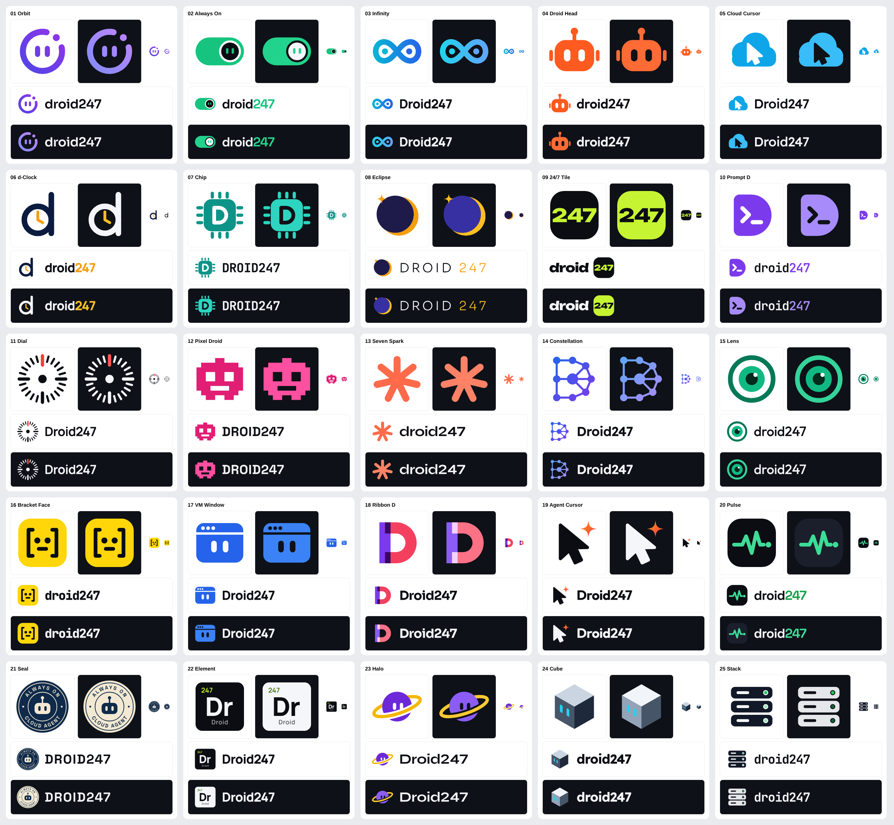

## What's in each folder

| File | Use |
| --- | --- |
| `mark.svg` | Symbol only, for light backgrounds (app icon, favicon, avatar) |
| `mark-dark.svg` | Symbol only, for dark backgrounds |
| `lockup.svg` | Symbol + wordmark, horizontal, for light backgrounds |
| `lockup-dark.svg` | Symbol + wordmark, horizontal, for dark backgrounds |

All files are standalone vector SVGs with transparent backgrounds. The wordmark text is converted to outlines, so nothing depends on installed fonts. Every symbol is drawn on a 120 × 120 grid and is checked at 16 px and 32 px.

Wordmark typefaces are open source (SIL Open Font License) from Google Fonts: Sora, Space Grotesk, Manrope, Outfit, Lexend, JetBrains Mono, Unbounded and Syne.

## Concepts

| # | Mark | Name | Idea | Typeface | Files |
| --- | --- | --- | --- | --- | --- |
| 01 | 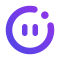 | **Orbit** | A satellite in permanent orbit around a droid face. The ring never closes, the work never stops. | Sora | [`01-orbit/`](01-orbit/) |
| 02 | 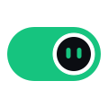 | **Always On** | A switch that is permanently flipped on. The knob doubles as a little droid peeking out. | Space Grotesk | [`02-always-on/`](02-always-on/) |
| 03 | 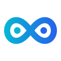 | **Infinity** | An endless loop for 24/7 work. Its two halves read as eyes, so the symbol is also a face. | Manrope | [`03-infinity/`](03-infinity/) |
| 04 |  | **Droid Head** | The friendly, literal robot. Approachable for a consumer product and very recognisable at small sizes. | Outfit | [`04-droid-head/`](04-droid-head/) |
| 05 |  | **Cloud Cursor** | A cloud with a cursor cut out of it. The agent works the computer in the cloud for you. | Lexend | [`05-cloud-cursor/`](05-cloud-cursor/) |
| 06 | 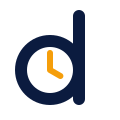 | **d-Clock** | A lowercase d whose bowl is a clock face. Time keeps moving and so does the agent, around the clock. | Manrope | [`06-d-clock/`](06-d-clock/) |
| 07 | 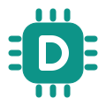 | **Chip** | The agent as silicon, with a D etched into the die. Technical, precise, engineering-led. | JetBrains Mono | [`07-chip/`](07-chip/) |
| 08 | 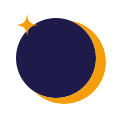 | **Eclipse** | A dark disc with a rim of light and one star: it keeps working while you sleep. Calm and premium. | Sora | [`08-eclipse/`](08-eclipse/) |
| 09 | 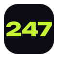 | **24/7 Tile** | Purely typographic. The word is followed by a bold 247 badge, and the badge alone works as the app icon. | Unbounded | [`09-tile-247/`](09-tile-247/) |
| 10 | 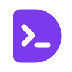 | **Prompt D** | A solid D carrying a command prompt. Speaks to developers and power users. | JetBrains Mono | [`10-prompt-d/`](10-prompt-d/) |
| 11 |  | **Dial** | A precise 24-hour watch dial with the current hour lit. Engineered, reliable, never off the clock. | Manrope | [`11-dial/`](11-dial/) |
| 12 | 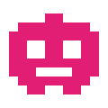 | **Pixel Droid** | An 8-bit robot on a strict grid. Playful, nostalgic and pixel-perfect at favicon sizes. | Space Grotesk | [`12-pixel-droid/`](12-pixel-droid/) |
| 13 |  | **Seven Spark** | Seven rays, one per day of the week, form an energetic spark. Editorial and warm. | Syne | [`13-seven-spark/`](13-seven-spark/) |
| 14 | 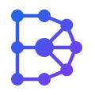 | **Constellation** | A D drawn as a network of connected nodes with the agent at its core. Connects tools, apps and services. | Lexend | [`14-constellation/`](14-constellation/) |
| 15 | 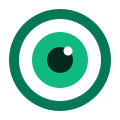 | **Lens** | The agent's single attentive eye. Watches, understands and acts. Live view is a core feature. | Outfit | [`15-lens/`](15-lens/) |
| 16 | 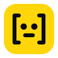 | **Bracket Face** | Code brackets that look back at you, on a bright yellow tile. Witty, bold and developer-friendly. | JetBrains Mono | [`16-bracket-face/`](16-bracket-face/) |
| 17 | 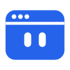 | **VM Window** | Your own cloud computer, with someone home. Says exactly what the product is: a computer with an agent in it. | Manrope | [`17-vm-window/`](17-vm-window/) |
| 18 | 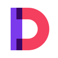 | **Ribbon D** | Two layered planes fold into a D, with a third colour where they overlap. Modern, confident monogram. | Sora | [`18-ribbon-d/`](18-ribbon-d/) |
| 19 |  | **Agent Cursor** | A pointer with an AI spark. Computer use in a single glyph: the agent clicks and types for you. | Outfit | [`19-agent-cursor/`](19-agent-cursor/) |
| 20 | 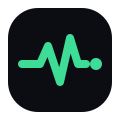 | **Pulse** | A heartbeat that never flatlines, ending in a live dot. Always running, always reporting. | Space Grotesk | [`20-pulse/`](20-pulse/) |
| 21 |  | **Seal** | An emblem with the promise printed around the edge: always on, cloud agent. Trustworthy and established. | Space Grotesk | [`21-seal/`](21-seal/) |
| 22 | 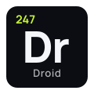 | **Element** | Dr, element number 247 on the periodic table of agents. Clever and system-like. | Manrope | [`22-element/`](22-element/) |
| 23 | 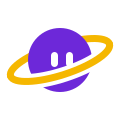 | **Halo** | A droid head with a planetary ring passing in front of and behind it. Always in orbit around you. | Syne | [`23-halo/`](23-halo/) |
| 24 | 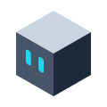 | **Cube** | The per-user VM as an isometric box with the agent's eyes looking out. Dimensional and infrastructural. | Lexend | [`24-cube/`](24-cube/) |
| 25 | 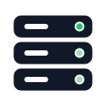 | **Stack** | A server rack that never sleeps. The top light is always green. Infrastructure-first and reliable. | JetBrains Mono | [`25-stack/`](25-stack/) |
## After a concept is chosen

- Remove the other 24 concepts and move the chosen one to `brand/logo/`.
- Add a single-colour (monochrome) version and a stacked lockup.
- Export app icons for Expo (iOS, Android adaptive icon), Tauri (`.ico`, `.icns`, PNG sizes), web favicons and the PWA manifest.
- Write down brand colours, clear space and minimum size.
