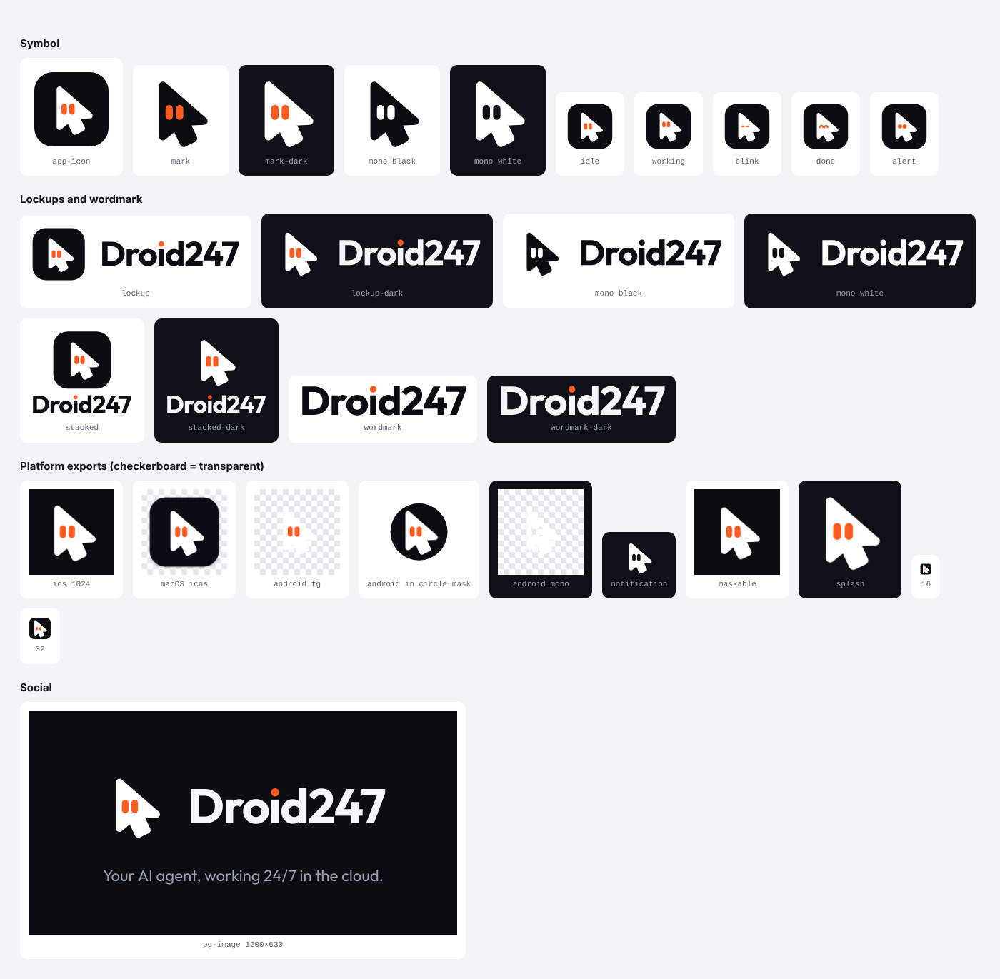

# Droid247 logo

The Droid247 logo is **Cursor Droid**: a mouse cursor with two orange eyes. It shows what the product does (an agent that uses a computer for you) and gives it a character.



The SVGs in `svg/` are the master files. Every PNG in `exports/` was rendered from them. All text is converted to outlines, so no font needs to be installed.

## Colours

| Name | Hex | Use |
| --- | --- | --- |
| Ink | `#0B0D12` | App icon tile, logo on light backgrounds, dark UI backgrounds |
| White | `#FFFFFF` | Cursor body, logo on dark backgrounds |
| Mist | `#F4F6FA` | Wordmark on dark backgrounds |
| Signal Orange | `#FF5A1F` | Eyes, the dot on the "i", accents |

Signal Orange has a contrast ratio of 3.1:1 on white and 6.2:1 on Ink. Use it for icons, large text and accents. Don't use it for small body text on white.

## Typography

The wordmark is set in [Outfit](https://fonts.google.com/specimen/Outfit) Bold (700) with −2.5% letter spacing, and the dot of the "i" is Signal Orange. Always use the supplied wordmark files; never retype it. Outfit is free (SIL Open Font License) and can be used for headings in the product and marketing.

## Which file to use

| Situation | File |
| --- | --- |
| Light background | `svg/lockup.svg` (symbol on its black tile) |
| Dark background | `svg/lockup-dark.svg` (no tile, white cursor) |
| Narrow or square space | `svg/lockup-stacked.svg`, `svg/lockup-stacked-dark.svg` |
| Symbol only, light / dark background | `svg/mark.svg`, `svg/mark-dark.svg` |
| Over photos or busy backgrounds | `svg/app-icon.svg` (the tile keeps it legible) |
| Name only | `svg/wordmark.svg`, `svg/wordmark-dark.svg` |
| One-colour printing, embossing, stamps | `svg/mark-mono-*.svg`, `svg/lockup-mono-*.svg` |
| 32 px and smaller | `svg/favicon.svg`: larger cursor and wider-spaced eyes, so it stays legible |
| Loading screens | `svg/animated.svg` (blinks every 4 seconds) |

## Clear space and minimum size

- Keep empty space of at least **25% of the symbol's height** on every side of the logo.
- Minimum sizes: symbol **16 px** (use `favicon.svg` up to 32 px), horizontal lockup **100 px** wide (25 mm in print), stacked lockup **64 px** wide.

## Expressions

The eyes can change to show what the agent is doing. Use these in the product (task status, notifications, empty states), never in the logo itself.

| File | When |
| --- | --- |
| `expressions/idle.svg` | Default, waiting for a task |
| `expressions/working.svg` | A task is running (eyes look up at the tip of the cursor) |
| `expressions/blink.svg` | Animation frame; see `animated.svg` |
| `expressions/done.svg` | Task finished |
| `expressions/alert.svg` | Needs the user (approval, a code, a question) |

## Don't

- Recolour the eyes (except in the one-colour versions) or the dot on the "i".
- Rotate, flip, stretch or outline the cursor.
- Put the white cursor without its tile on a light background, or the black cursor on a dark one.
- Add shadows, glows or gradients.
- Retype the wordmark or put the symbol next to a different font.

## Platform exports

| Folder | Contents |
| --- | --- |
| `exports/ios/` | `icon-1024.png`: square, no transparency (iOS rounds the corners itself) |
| `exports/android/` | Adaptive icon foreground and monochrome layers (1024 px, content inside the 66% safe zone), Play Store icon, white notification icon |
| `exports/expo/` | `splash-icon.png` for the splash screen |
| `exports/web/` | `favicon.ico` (16/32/48), `favicon.svg`, PNG favicons, `apple-touch-icon.png`, PWA icons including a maskable one |
| `exports/desktop/` | Tauri icon set: PNG sizes, Windows `icon.ico` and Store logos, macOS `icon.icns` (macOS-style padded tile) |
| `exports/social/` | `og-image.png` (1200×630 link preview), profile avatars |
| `exports/email/` | `lockup-dark.png`: dark lockup at 3× (108 px tall, shown at 36 px) for the Ink header of transactional emails |

`svg/platform/` holds the source compositions for these exports.

### Expo (`apps/client/app.json`)

Copy the files into `apps/client/assets/` (or adjust the paths) and configure:

```json
{
  "expo": {
    "icon": "./assets/icon-1024.png",
    "android": {
      "adaptiveIcon": {
        "foregroundImage": "./assets/adaptive-foreground.png",
        "monochromeImage": "./assets/adaptive-monochrome.png",
        "backgroundColor": "#0B0D12"
      }
    },
    "web": { "favicon": "./assets/favicon-48.png" },
    "plugins": [
      ["expo-splash-screen", { "image": "./assets/splash-icon.png", "imageWidth": 200, "backgroundColor": "#0B0D12" }],
      ["expo-notifications", { "icon": "./assets/notification-icon.png", "color": "#FF5A1F" }]
    ]
  }
}
```

### Tauri (`apps/desktop`)

Copy `exports/desktop/` to `apps/desktop/src-tauri/icons/` and list the icons in `tauri.conf.json`:

```json
"bundle": {
  "icon": ["icons/32x32.png", "icons/128x128.png", "icons/128x128@2x.png", "icons/icon.icns", "icons/icon.ico"]
}
```

### Web

Serve the files from `exports/web/` and `exports/social/` at the site root:

```html
<link rel="icon" href="/favicon.ico" sizes="32x32">
<link rel="icon" href="/favicon.svg" type="image/svg+xml">
<link rel="apple-touch-icon" href="/apple-touch-icon.png">
<link rel="manifest" href="/site.webmanifest">
<meta name="theme-color" content="#0B0D12">
<meta property="og:image" content="/og-image.png">
```

Icons for `site.webmanifest`:

```json
"icons": [
  { "src": "/icon-192.png", "sizes": "192x192", "type": "image/png" },
  { "src": "/icon-512.png", "sizes": "512x512", "type": "image/png" },
  { "src": "/icon-maskable-512.png", "sizes": "512x512", "type": "image/png", "purpose": "maskable" }
]
```
